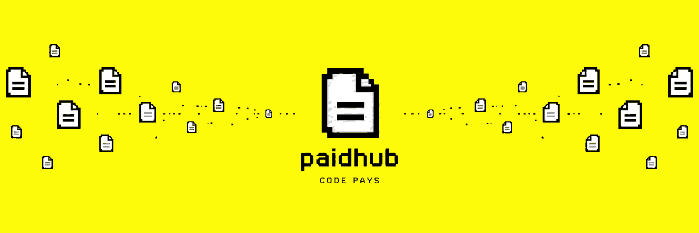
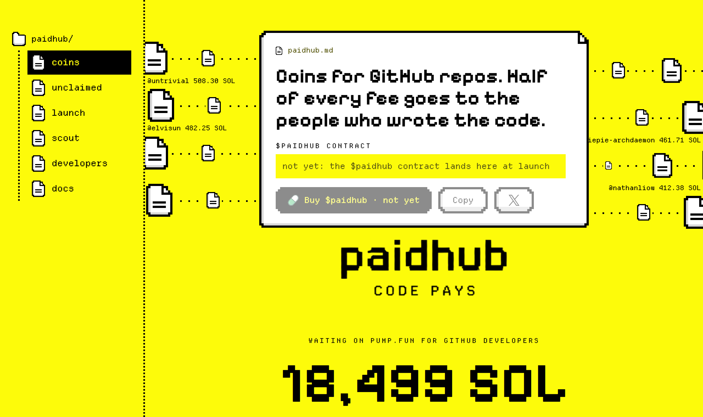
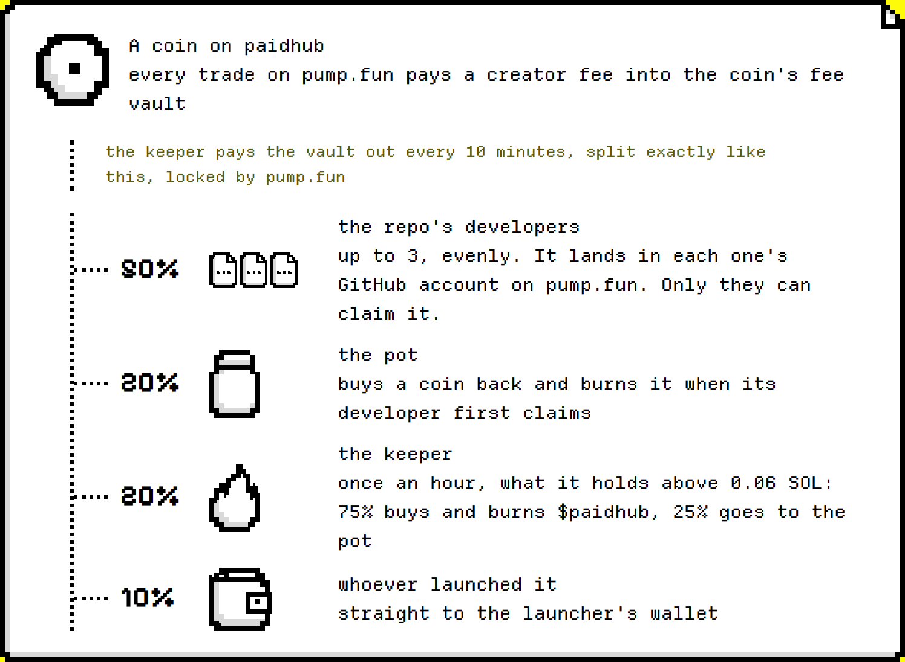
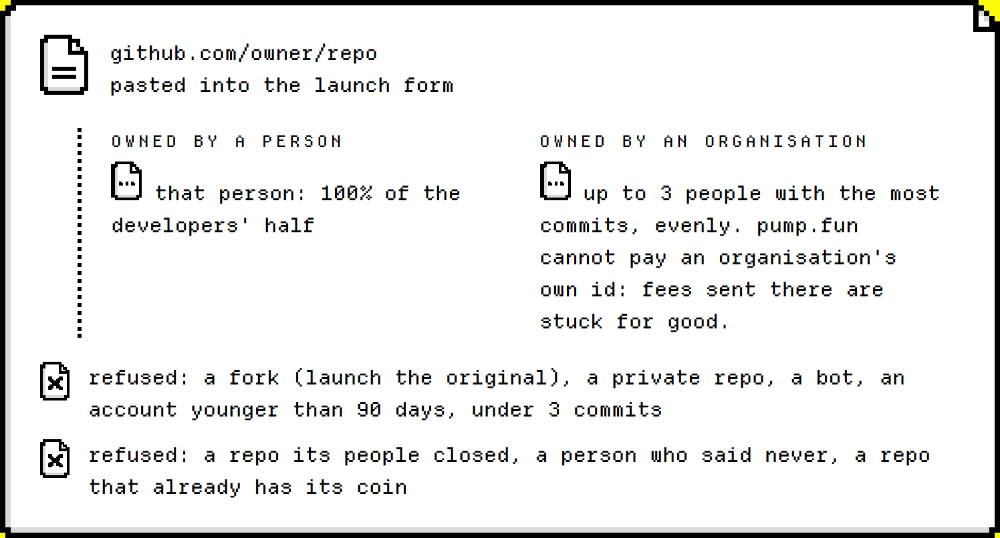
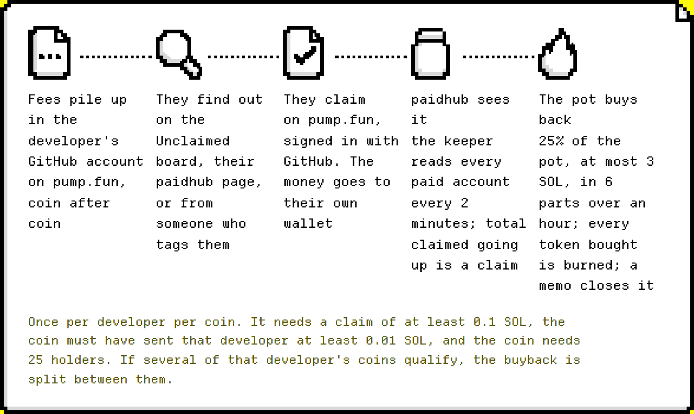
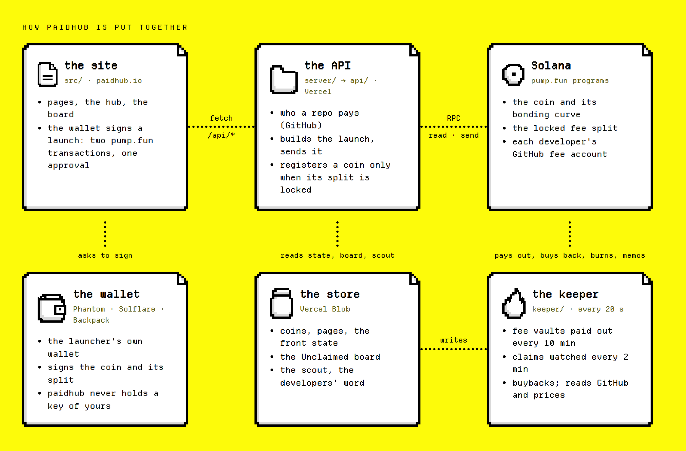

<p align="center">
  <a href="https://paidhub.io"></a>
</p>

<h3 align="center">Coins for GitHub repos on pump.fun.<br>Half of every fee goes to the people who wrote the code.</h3>

<p align="center">
  <a href="https://paidhub.io">paidhub.io</a> ·
  <a href="https://paidhub.io/docs">Docs</a> ·
  <a href="https://paidhub.io/unclaimed">Who is owed</a> ·
  <a href="https://paidhub.io/developers">For developers</a> ·
  <a href="#run-it">Run it</a>
</p>

<p align="center">
  <a href="https://github.com/paidhubdotfun/paidhub/actions/workflows/ci.yml"></a>
  <a href="LICENSE"></a>
  
  
  
</p>

---

## What it is

Anyone can launch one coin per GitHub repo. Half of the coin's creator fees land in pump.fun's own GitHub
fee accounts for that repo's developers. **paidhub never holds that money and cannot move it**: only the
developer can claim it, on pump.fun, by signing in with GitHub.

The first time a developer claims, the pad's pot buys their coin back over an hour and burns every token it
buys. Meanwhile [over 22,000 SOL](https://paidhub.io/unclaimed) already waits on pump.fun for GitHub
developers who have never claimed it.

<p align="center"></p>

## Highlights

- **Developers' money is out of our reach.** It sits in pump.fun's GitHub fee account for their numeric id.
  pump.fun's own key co-signs every claim.
- **The right people get paid.** A personal repo pays its owner; an organisation's repo pays its three
  people with the most commits. Never an organisation, a bot, a fork or an account younger than 90 days.
- **A claim pays holders.** A developer's first claim sets off a buyback of their coin from the pot, burned.
- **No program of its own.** A launch is two ordinary pump.fun transactions from the launcher's wallet.
- **One coin per repo**, keyed by the repo's numeric id, so renames and transfers keep it.
- **Developers decide.** Never, I'm in, or close a repo. paidhub does not email anyone or open issues.
- **Open board.** Every GitHub fee account on pump.fun, from any launchpad, read off the chain every hour.

## How it works

1. **Paste a repo.** paidhub works out who wrote it.
2. **Launch the coin** from your own wallet. pump.fun locks its fee split for good.
3. **The developers get paid.** Every 10 minutes the keeper pays out the coin's fee vault:

<p align="center"></p>

4. **A claim pays holders.** A developer's first claim makes the pot spend a quarter of itself, at most 3 SOL,
   buying that coin in six parts over an hour, and burn all of it.

<details>
<summary><b>Who a coin pays</b></summary>
<br>
<p align="center"></p>

People are identified by their numeric GitHub id, which survives renames. pump.fun loses fees routed to an
organisation's id, so paidhub pays the organisation's people instead.
</details>

<details>
<summary><b>From a claim to a buyback</b></summary>
<br>
<p align="center"></p>

Once per developer per coin. It needs a claim of at least 0.1 SOL, the coin must have sent that developer at
least 0.01 SOL, and the coin needs 25 holders. Every number lives in [`shared/rules.js`](shared/rules.js),
read by the site, the API and the keeper alike.
</details>

## Check it yourself

A launch is two transactions the launcher's wallet signs in one approval:

| transaction | instructions |
|---|---|
| 1 · the coin | `create_v2`, the launcher's token account, `buy_v2` |
| 2 · the split | `create_social_fee_pda` for each developer, `create_fee_sharing_config`, `update_fee_shares_v2` |

The API sends a transaction only if the launcher pays for it, it names the coin and it calls nothing but
pump.fun's programs and Solana's system, token and compute budget programs. A coin is registered only once
the chain shows its split locked to exactly the pad's shares
([`server/lib/register.js`](server/lib/register.js), [`server/lib/chain.js`](server/lib/chain.js)).

| what | where |
|---|---|
| a developer's GitHub account on pump.fun | PDA `["social-fee-pda", <github id>, [2]]` of the fee program |
| a coin's split | PDA `["sharing-config", <mint>]` of the fee program, `admin_revoked = true` |
| pump.fun fee program | [`pfeeUxB6jkeY1Hxd7CsFCAjcbHA9rWtchMGdZ6VojVZ`](https://solscan.io/account/pfeeUxB6jkeY1Hxd7CsFCAjcbHA9rWtchMGdZ6VojVZ) |
| pump.fun | [`6EF8rrecthR5Dkzon8Nwu78hRvfCKubJ14M5uBEwF6P`](https://solscan.io/account/6EF8rrecthR5Dkzon8Nwu78hRvfCKubJ14M5uBEwF6P) |
| the pot and the keeper | `POT_WALLET` and `KEEPER_WALLET` in [`public/config.js`](public/config.js) |

```js
import { socialFeePda } from "@pump-fun/pump-sdk";

// a GitHub user id -> the account only that person can claim from
socialFeePda("76467478", 2).toBase58();
```

## How it is built

<p align="center"></p>

| folder | what is in it |
|---|---|
| [`src/`](src) | the website: one page per file in `src/pages`, the hub animation in `hub.js` |
| [`server/`](server) | the API routes, shared code in `server/lib` |
| [`api/`](api) | the same routes bundled for Vercel by `tools/bundle.mjs` (generated, do not edit) |
| [`shared/`](shared) | `rules.js`: every number of the mechanic |
| [`keeper/`](keeper) | pays out fee vaults, watches claims, runs buybacks, builds the board and the scout |
| [`tests/`](tests) | the whole money path on a local chain with the real pump.fun programs, and unit tests |
| [`tools/`](tools) | API bundling, mainnet program dumps for the tests, reading settings |
| [`public/`](public) | what the site serves: `config.js`, the pixel art, fonts, official marks |
| [`docs/`](docs) | the pictures in this README |

## Run it

Node 22 (see [`.nvmrc`](.nvmrc)), then `npm install`.

| command | what it does |
|---|---|
| `npm run dev` | the site on Vite; `/api/*` runs straight from `server/` |
| `npm test` | unit tests: shares, the developers' split, repo links, the launch form |
| `npm run fixtures` | dumps pump.fun, PumpSwap, the fee program and the accounts they read from mainnet into `tests/fixtures` |
| `npm run test:chain` | launch, payout, claim, buyback and burn on `solana-test-validator` with those dumps; pump.fun's claim authority is swapped for a test key so a real claim runs |
| `npm run bundle` | rebuilds `api/` from `server/` |
| `npm run keeper` | the keeper, on a 20 second pulse |

Settings come from a `.config/.env` above the repo, never from the repo itself. [`.env.example`](.env.example)
lists every name. `api/` holds CommonJS bundles because Vercel's tracer misses `@solana/web3.js` in ESM functions.

## What paidhub cannot do

- Pay out a developer's money, or stop them from claiming it.
- Change a split or undo a coin. pump.fun locks the split at launch.
- Speak for developers. A coin is a community coin; the developers have not endorsed it unless they say they are in.

Found a way to break any of this? Please report it privately: [SECURITY.md](.github/SECURITY.md).

## Credits

[Departure Mono](https://departuremono.com) by Helena Zhang and Tobias Fried (MIT) ·
[Pixelify Sans](https://fonts.google.com/specimen/Pixelify+Sans) (OFL) ·
[@pump-fun/pump-sdk](https://www.npmjs.com/package/@pump-fun/pump-sdk) ·
GitHub's [star history endpoint](https://github.blog/changelog/2026-09-04-new-api-endpoint-provides-privacy-safe-star-history-data) ·
prices from Solana Tracker and DexScreener.

## License

[MIT](LICENSE). Not affiliated with GitHub or pump.fun.
